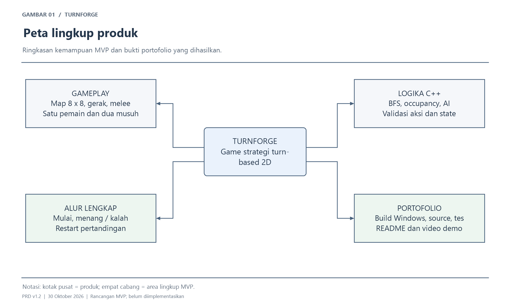
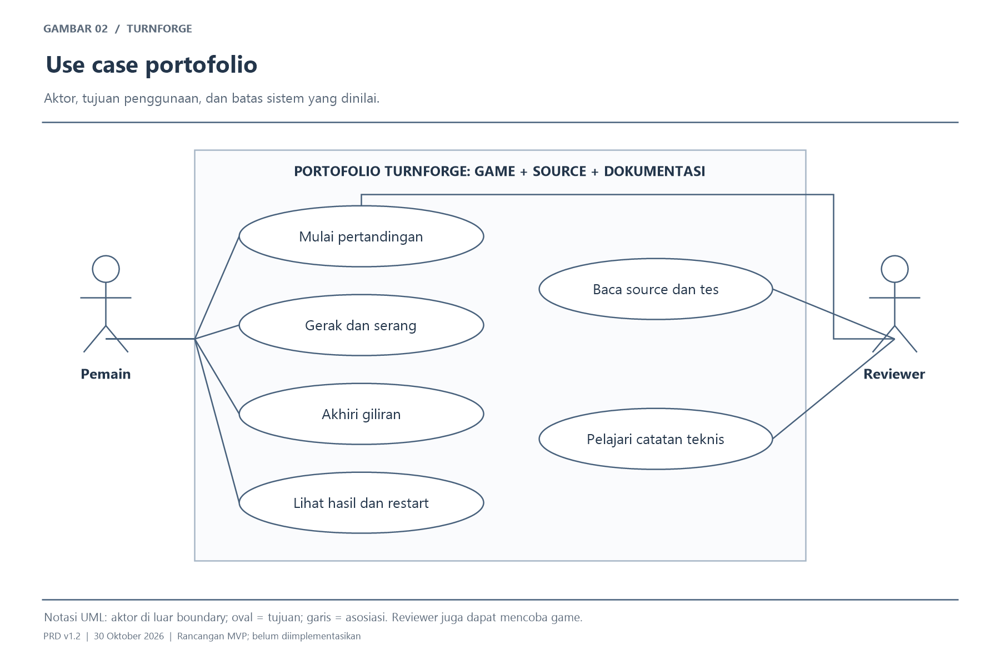
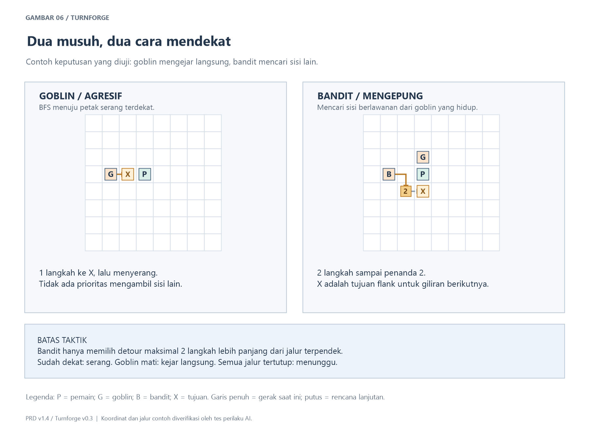
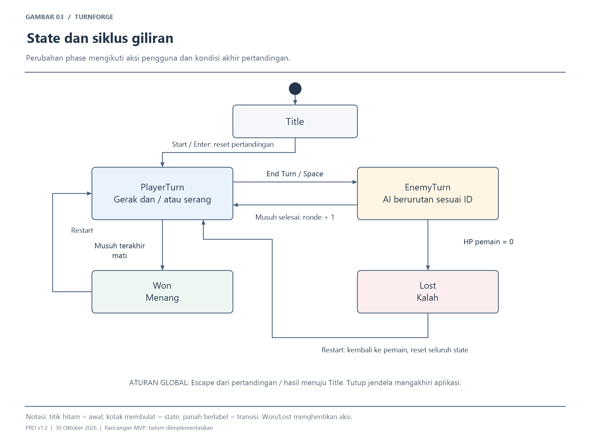
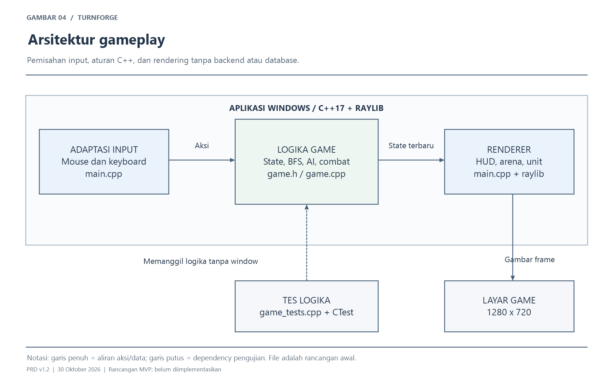
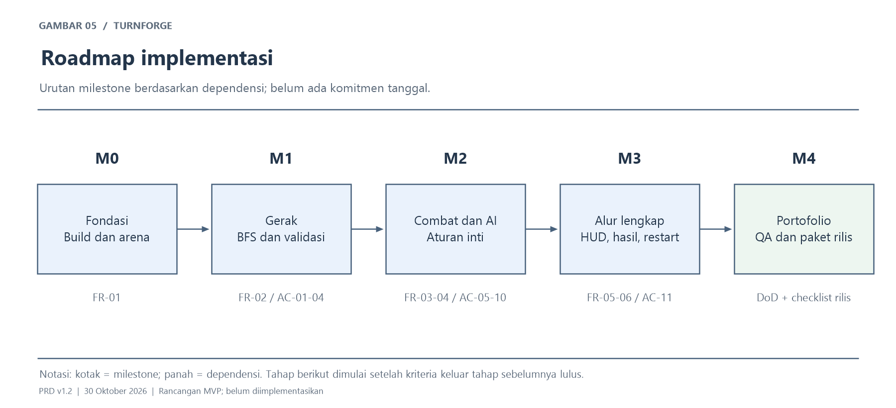

# PRD — Turnforge *(nama kerja)*

| | |
|---|---|
| **Versi** | 1.7 — demo gameplay lokal |
| **Tanggal** | 30 Oktober 2026 |
| **Pemilik produk** | Pengguna / pengembang project |
| **Status** | MVP v0.5 dengan karakter 2D, AI berbeda, Bertahan, dan preview aksi musuh diimplementasikan; hasil dan batas verifikasi ada di [catatan pengujian](docs/preview-verification.md) |
| **Platform** | Windows desktop; target awal ThinkPad L13 Yoga Gen 1, RAM 16 GB, Intel integrated graphics |
| **Bahasa antarmuka** | Indonesia |

> Catatan: statistik gameplay, durasi, target performa, dan rancangan teknis adalah keputusan awal yang perlu divalidasi setelah prototipe berjalan. Hasil implementasi dan pengukuran aktual dicatat terpisah di [catatan pengujian](docs/preview-verification.md); target dan estimasi di PRD ini tetap merupakan acuan desain.

## Daftar Isi

1. Ringkasan Eksekutif
2. Latar Belakang & Problem Statement
3. Visi, Tujuan, Non-Tujuan & Metrik Sukses
4. Pengguna & Persona
5. Ruang Lingkup & Prioritas (MoSCoW)
6. Model Gameplay & Aturan Permainan
7. Kebutuhan Fungsional
8. Kebutuhan Non-Fungsional
9. UX, Navigasi & Wireframe
10. Arsitektur, Tech Stack & Desain Teknis
11. Analytics & Telemetri
12. Strategi Pengujian & QA
13. Distribusi: Build Lokal → Portofolio
14. Roadmap & Milestone
15. Risiko & Mitigasi
16. Asumsi & Pertanyaan Terbuka
17. Lampiran

---

## 1. Ringkasan Eksekutif

**Turnforge** adalah game strategi turn-based 2D untuk satu pemain. Pemain mengendalikan satu unit di arena 8×8, memilih posisi, dan mengalahkan dua musuh menggunakan serangan jarak dekat.

Project menjadi portofolio awal gameplay programming dengan C++: aturan permainan, BFS, AI sederhana, state management, debugging, dan pengujian. Visual memakai sprite karakter 2D: kesatria pemain, goblin, dan bandit. Arena tetap berbasis grid, dengan animasi ringan untuk idle, gerak, serang, terkena damage, dan kematian.

### Keputusan dari percakapan

| Topik | Keputusan | Status |
|---|---|---|
| Tujuan | Portofolio untuk melamar posisi programmer di perusahaan game | Dinyatakan pengguna |
| Bahasa | C++ | Dinyatakan pengguna |
| Fokus | Game ringan dengan penekanan pada logika | Dinyatakan pengguna |
| Perangkat | ThinkPad L13 Yoga Gen 1, RAM 16 GB, Intel integrated graphics | Dinyatakan pengguna |
| Konsep | Tactical turn-based 2D di grid, memakai raylib | Rancangan dari PRD v1.0 |
| Lingkup awal | Satu map, satu pemain, dua musuh | Rancangan dari PRD v1.0 |
| Visual v0.2 | Karakter 2D dengan presentasi aksi; tetap turn-based | Diminta pengguna |
| AI v0.3 | Goblin mengejar; bandit mencari sisi lain dengan detour terbatas | Disetujui pengguna |
| Bertahan v0.4 | Mengganti serangan untuk mengurangi damage musuh sampai giliran pemain berikutnya | Disetujui pengguna |
| Preview v0.5 | Prakiraan tujuan gerak, serangan, dan HP yang hilang jika giliran diakhiri sekarang | Rancangan kelanjutan dari saran sebelumnya |

### Pemetaan produk



*Gambar 1. Peta lingkup produk Turnforge.*

---

## 2. Latar Belakang & Problem Statement

### 2.1 Masalah yang ingin diselesaikan

| ID | Masalah | Dampak |
|---|---|---|
| P1 | Pengguna perlu bukti keterampilan C++ untuk portofolio game | Latihan sintaks saja belum menunjukkan implementasi sistem gameplay |
| P2 | Perangkat memakai GPU terintegrasi | Pemilihan engine dan scope perlu menjaga beban pengembangan |
| P3 | Project terlalu luas berisiko tidak selesai | Sulit menghasilkan build yang dapat dicoba reviewer |
| P4 | Logika sulit dinilai bila tidak ada demo dan penjelasan | Kontribusi serta keputusan teknis kurang terlihat |

### 2.2 Peluang

Arena kecil dengan aturan pasti memungkinkan sistem gerak, combat, AI, dan state dibuat sampai tuntas. Hasilnya dapat dimainkan sekaligus dibaca source-nya tanpa membutuhkan produksi aset yang besar.

---

## 3. Visi, Tujuan, Non-Tujuan & Metrik Sukses

### 3.1 Visi

> Menghasilkan game strategi kecil yang selesai, mudah dicoba, dan cukup jelas untuk menjelaskan kemampuan gameplay programming pemiliknya.

### 3.2 Tujuan Produk

| ID | Tujuan |
|---|---|
| G1 | Menghasilkan alur lengkap mulai → bertarung → menang/kalah → restart |
| G2 | Menunjukkan logika C++ yang terpisah dari rendering dan dapat diuji |
| G3 | Menunjukkan BFS, validasi aksi, dan AI yang konsisten |
| G4 | Menghasilkan build Windows dan dokumentasi portofolio yang dapat dicoba |
| G5 | Memungkinkan pemilik menjelaskan keputusan kode dan edge case saat interview |

### 3.3 Non-Tujuan MVP

Multiplayer, 3D, Unreal Engine, inventory, equipment, skill tree, procedural map, editor map, banyak level, save/load, akun, backend, serta audio dan animasi frame-by-frame kompleks tidak termasuk MVP. Tidak ada target membangun engine sendiri. Portofolio ini tidak menggantikan semua syarat lowongan atau pengalaman engine tertentu.

### 3.4 Metrik Sukses — hipotesis awal

| Kategori | Metrik | Target | Cara validasi |
|---|---|---|---|
| Kelengkapan | Kebutuhan Must | Seluruh acceptance criteria lulus | Matriks QA Bagian 12 |
| Gameplay | Durasi pertandingan | Sekitar 3–5 menit setelah balance | Catatan playtest; bukan hasil terukur |
| Kejelasan | Pemain memahami aksi valid/invalid | Kontrol, jangkauan, dan alasan penolakan terlihat | Observasi mencoba game |
| Teknis | Respons, FPS, memori, stabilitas | Sesuai NFR Bagian 8 | Build Release di laptop pengguna |
| Distribusi | Build dapat dicoba tanpa compiler | Paket berjalan di luar folder source | Uji paket rilis |
| Portofolio | Demo dan penjelasan kontribusi | Source, README, video 60–90 detik, satu catatan teknis | Checklist rilis |

---

## 4. Pengguna & Persona

Persona berikut merupakan profil kebutuhan hipotetis, bukan hasil riset pengguna.

| Persona/aktor | Kebutuhan | Hambatan | Fitur terkait |
|---|---|---|---|
| Pemain demo | Mencoba pertarungan strategi singkat | Tidak ingin membaca petunjuk panjang | Instruksi singkat, highlight, log aksi, restart |
| Reviewer portofolio | Memeriksa demo, kode, dan keputusan teknis | Waktu review terbatas | Build siap jalan, README, video, tes logika |
| Pemilik project | Mempelajari dan menjelaskan C++ gameplay | Level C++ dan toolchain belum dipastikan | Milestone bertahap, scope kecil, aturan deterministik |

### Use case per aktor



*Gambar 2. Use case portofolio Turnforge.*

---

## 5. Ruang Lingkup & Prioritas (MoSCoW)

| Prioritas | Fitur |
|---|---|
| **Must** | Map 8×8, satu pemain, dua musuh melee dengan AI berbeda, gerak BFS, combat, Bertahan, preview aksi musuh, turn, AI, karakter 2D dengan animasi ringan, HUD/feedback, layar awal/hasil/restart, tes, build Windows |
| **Should** | Polesan setelah playtest jika diperlukan; tidak ada fitur Should yang wajib untuk rilis pertama |
| **Could** | Perluasan setelah MVP berdasarkan feedback atau kebutuhan lowongan; belum ditetapkan |
| **Won't** | Seluruh non-tujuan pada Bagian 3.3 |

### Tahapan rilis ringkas

| Rilis | Sasaran | Isi |
|---|---|---|
| Prototipe | Membuktikan aturan inti | Map, unit, BFS, validasi gerak |
| MVP | Game lengkap bisa dimainkan | Semua fitur Must, menang/kalah/restart |
| Rilis portofolio | Reviewer dapat mencoba dan menilai | Paket Windows, source, README, video, catatan teknis |

---

## 6. Model Gameplay & Aturan Permainan

### 6.1 Arena, koordinat, dan occupancy

- Arena tetap 8×8; `(0, 0)` berada di kiri atas. `x` bertambah ke kanan, `y` ke bawah.
- Gerak hanya atas, kanan, bawah, kiri; setiap langkah bernilai satu.
- Tembok, posisi di luar map, dan unit hidup menghalangi gerakan.
- Satu petak hanya dapat ditempati satu unit hidup. Unit mati segera berhenti menghalangi petak dan tidak dapat ditarget.

Map awal, dari baris `y=0` sampai `y=7`:

```text
........
......E.
..##....
...#....
...#....
......E.
.P......
........
```

`P`: pemain `(1, 6)`. `E`: musuh `(6, 1)` dan `(6, 5)`. `#`: tembok. `.`: lantai. Simbol spawn menjadi unit, sementara tile dasarnya adalah lantai.

### 6.2 Statistik awal dan damage

| Properti | Pemain | Setiap musuh |
|---|---|---|
| HP maksimum | 12 | 6 |
| Damage | 3 | 2 |
| Maksimum jarak gerak per giliran | 3 langkah | 2 langkah |
| Jarak serang | 1 petak ortogonal | 1 petak ortogonal |
| Batas aksi | 1 gerak, 1 serangan atau Bertahan | 1 gerak, 1 serangan |

Damage selalu mengenai target valid, tanpa critical hit atau angka acak. Bertahan mengurangi setiap serangan musuh dari 2 menjadi 1 sampai giliran pemain berikutnya; tidak memulihkan HP. HP minimum 0. Serangan valid jika Manhattan distance `abs(dx) + abs(dy) == 1`.

### 6.3 Giliran pemain

1. Pemain mendapat giliran pertama. Jatah gerak dan serang direset pada awal gilirannya.
2. Klik lantai reachable untuk bergerak sekali. Panjang jalur BFS harus maksimal tiga langkah.
3. Gerak kurang dari tiga langkah tetap menghabiskan seluruh jatah gerak; tidak boleh bergerak kedua kali.
4. Klik musuh hidup yang bersebelahan untuk menyerang sekali.
5. Menyerang menutup kesempatan bergerak pada giliran itu. Urutan valid: gerak → serang, gerak → Bertahan, gerak saja, serang saja, Bertahan saja, atau lewat.
6. End Turn/Space mengakhiri giliran kapan saja. Tidak ada auto End Turn ketika aksi habis; pemain tetap mengakhiri giliran secara eksplisit.
7. Aksi tidak valid dan klik petak sendiri tidak menghabiskan jatah. Tampilkan alasan penolakan singkat.
8. Membunuh musuh terakhir langsung menghasilkan kemenangan tanpa menunggu End Turn.
9. G/tombol Bertahan tersedia jika belum menyerang. Aksi ini menghabiskan serangan dan sisa gerak; tidak dapat ditumpuk atau dipakai setelah menyerang.
10. Bertahan tetap aktif setelah End Turn, mengurangi setiap hit musuh menjadi 1, lalu dihapus saat giliran pemain berikutnya dimulai, meskipun tidak menerima hit. Bertahan tidak otomatis mengakhiri giliran dan tidak mencegah kematian.

### 6.4 Giliran musuh dan AI

1. Nonaktifkan input aksi pemain selama giliran musuh.
2. Musuh bertindak satu per satu sesuai ID spawn; unit mati dilewati.
3. Musuh yang sudah bersebelahan menyerang sekali dan tidak bergerak.
4. Selain itu, hitung jalur BFS ke empat petak kosong di samping pemain. Goblin memilih jalur terpendek. Jika goblin hidup, bandit memilih tujuan yang paling jauh dari goblin (jarak kuadrat) di antara jalur yang paling banyak dua langkah lebih panjang dari jalur terpendek. Jika goblin mati, bandit mengejar langsung. Petak pemain tetap tidak bisa dilalui.
5. Jika ada jalur, maju maksimal dua langkah; setelah bergerak, serang sekali jika sudah bersebelahan.
6. Jika tidak ada jalur, tunggu dan lanjutkan musuh berikutnya.
7. Hitung ulang jalur setiap musuh dengan occupancy terbaru untuk mencegah overlap.
8. Tetangga BFS dan kandidat target diperiksa atas, kanan, bawah, kiri. Goblin memecah seri dengan urutan itu. Bandit memprioritaskan jarak kuadrat terhadap goblin, lalu jalur lebih pendek, lalu urutan kandidat. Tujuan dihitung ulang setiap aksi; tidak ada reservasi atau teleport.
9. Setelah semua musuh hidup selesai, kembali ke pemain. Jika pemain mati di tengah urutan, langsung kalah dan batalkan sisa aksi.

Musuh aktif diberi highlight dan aksinya dicatat. Jeda presentasi sekitar 300 ms antarmusuh memakai update timer; jangan menggunakan blocking sleep pada loop render. Pada v0.2, karakter mengikuti lintasan ortogonal saat bergerak. Sistem menunggu presentasi aksi selesai sebelum aksi berikutnya; input gameplay dibatasi selama itu, sedangkan Escape tetap tersedia. Model menang/kalah tetap langsung, dengan layar hasil muncul setelah presentasi akhir selesai.



*Gambar 6. Contoh perilaku langsung versus mengepung yang diverifikasi melalui tes.*

Batas dua langkah tambahan mengacu pada panjang rencana jalur, bukan tambahan gerakan per giliran. Keduanya tetap bergerak maksimum dua petak dan menyerang sekali. Jika sudah berdampingan, keduanya langsung menyerang tanpa memutari pemain.

### 6.5 State dan ronde

State minimum: `Title`, `PlayerTurn`, `EnemyTurn`, `Won`, `Lost`.

- Start: `Title` → pertandingan baru, `PlayerTurn`.
- End Turn: `PlayerTurn` → `EnemyTurn`.
- Musuh selesai: `EnemyTurn` → `PlayerTurn`.
- Semua musuh mati: langsung `Won`. HP pemain 0: langsung `Lost`.
- State hasil menolak input aksi arena.
- Ronde dimulai dari 1, bertambah setelah giliran musuh selesai dan pertandingan masih berlanjut.
- Restart dari hasil mereset map, posisi, HP, jatah aksi, status Bertahan, urutan musuh, timer, ronde, dan log; pemain kembali mulai.
- Escape pada pertandingan/hasil kembali ke `Title`. Start sesudahnya membuat pertandingan baru; tidak ada resume. Tombol tutup jendela menutup aplikasi.

---

### 6.6 Preview aksi musuh

Saat giliran pemain dan animasi sudah selesai, tampilkan prakiraan jika End Turn dilakukan pada state saat ini. Salin state lalu jalankan AI yang sama sesuai urutan spawn; jangan mengubah pertandingan asli. Panah E1/E2 mengikuti maksimal dua langkah yang benar-benar akan ditempuh, bingkai tujuan menandai petak akhir, dan bingkai petak pemain menandai target serangan.

HUD menampilkan aksi tiap musuh serta total HP yang akan hilang, termasuk pengurangan Bertahan dan clamp ke HP tersisa. Musuh mati dilewati; musuh tanpa jalur menunggu; jika hit pertama mematikan, aksi musuh berikutnya tidak ditampilkan sebagai aksi yang akan terjadi. Prakiraan dihitung ulang setelah gerak, serang/kill, dan Bertahan. Sembunyikan selama animasi, giliran musuh, Title, dan hasil. Perubahan aksi pemain dapat mengubah prakiraan; ini bukan reservasi aksi musuh.

---

## 7. Kebutuhan Fungsional

| ID | Fitur | Prioritas | Fase |
|---|---|---|---|
| FR-01 | Arena dan inisialisasi unit | Must | Prototipe |
| FR-02 | Gerak, BFS, dan validasi | Must | Prototipe |
| FR-03 | Combat dan kematian | Must | MVP |
| FR-04 | Giliran dan AI musuh | Must | MVP |
| FR-05 | HUD, highlight, dan feedback | Must | MVP |
| FR-06 | Mulai, hasil, restart, dan keluar | Must | MVP |
| FR-07 | Bertahan dan indikator perisai | Must | v0.4 |
| FR-08 | Preview aksi musuh | Must | v0.5 |

### 7.1 Detail fitur Must

#### FR-01 Arena dan inisialisasi unit

**User story:** Sebagai pemain, saya ingin arena dan unit terlihat jelas agar dapat memahami posisi awal.

**Perilaku:** gunakan map, statistik, spawn, dan occupancy Bagian 6.1–6.2. Validasi konfigurasi awal saat tes/inisialisasi; jangan mulai pertandingan dengan spawn tidak legal.

**Kriteria penerimaan:**

- [ ] Tampil tepat satu pemain dan dua musuh pada posisi yang ditentukan.
- [ ] Spawn berada di lantai, dalam batas map, tidak overlap, dan musuh dapat mencapai area tetangga pemain pada konfigurasi awal.
- [ ] Tembok dan unit hidup menghalangi gerak; unit mati tidak menghalangi.

#### FR-02 Gerak, BFS, dan validasi

**User story:** Sebagai pemain, saya ingin melihat dan memilih petak reachable agar dapat merencanakan posisi.

**Perilaku:** terapkan Bagian 6.3; gunakan jarak jalur, bukan garis lurus. Klik di panel/luar arena tidak menghasilkan koordinat map valid.

**Kriteria penerimaan:**

- [ ] Gerak ke lantai kosong melalui jalur hingga tiga langkah berhasil sekali per giliran.
- [ ] Jalur memutari tembok dan tidak melewati unit hidup atau batas map.
- [ ] Gerak kedua, jarak berlebih, tujuan terputus, petak terisi, atau input di luar arena ditolak tanpa mengubah posisi/jatah.
- [ ] Klik petak sendiri tidak menghabiskan jatah gerak.

#### FR-03 Combat dan kematian

**User story:** Sebagai pemain, saya ingin menyerang musuh yang berdekatan agar dapat memenangkan pertandingan.

**Perilaku:** gunakan damage tetap Bagian 6.2. Serangan menutup gerak dan serangan berikutnya pada giliran tersebut.

**Kriteria penerimaan:**

- [ ] Serangan pada musuh hidup ortogonal berjarak satu menerapkan damage tepat sekali.
- [ ] Target diagonal, jauh, atau mati ditolak tanpa menghabiskan jatah serang.
- [ ] HP tidak negatif; unit HP 0 keluar dari occupancy dan target.
- [ ] Kematian musuh terakhir langsung memicu `Won`; kematian pemain memicu `Lost` dan menghentikan sisa aksi musuh.

#### FR-04 Giliran dan AI musuh

**User story:** Sebagai pemain, saya ingin musuh bertindak menurut aturan yang konsisten agar keputusan posisi dapat dipelajari.

**Perilaku:** terapkan urutan, batas aksi, pemilihan jalur, fallback menunggu, dan reset giliran pada Bagian 6.3–6.5.

**Kriteria penerimaan:**

- [ ] End Turn bekerja setelah nol, satu, atau dua aksi; jatah berikutnya direset dengan benar.
- [ ] Semua musuh hidup bertindak sesuai ID, maksimal satu gerak dan satu serangan.
- [ ] Musuh bersebelahan langsung menyerang; musuh jauh bergerak maksimal dua langkah dan menyerang bila sudah dekat.
- [ ] Musuh tanpa jalur menunggu; dua musuh tidak overlap dan memakai occupancy terbaru.
- [ ] State yang sama menghasilkan keputusan AI yang sama; pemain tidak dapat beraksi selama giliran musuh.
- [ ] Goblin mengejar langsung; bandit mengambil sisi lain jika jalur valid dalam budget detour dua langkah.
- [ ] Bandit kembali ke pendekatan langsung jika goblin mati, tidak macet pada tujuan tertutup, dan langsung menyerang jika sudah berdampingan.

#### FR-05 HUD, highlight, dan feedback

**User story:** Sebagai pemain, saya ingin memahami giliran, HP, dan aksi yang tersedia tanpa menebak.

**Perilaku:** panel kanan menampilkan HP pemain/musuh hidup, ronde, giliran, sisa aksi, Bertahan, End Turn, dan lima pesan aksi terakhir.

**Kriteria penerimaan:**

- [ ] Petak reachable hanya ditandai saat jatah gerak tersedia; highlight sesuai validasi aksi sebenarnya.
- [ ] Musuh yang dapat diserang, unit aktif, dan petak hover dibedakan secara jelas.
- [ ] Siluet kesatria, goblin (E1), bandit (E2), angka HP, ring, dan teks melengkapi warna.
- [ ] Gerak mengikuti petak valid; serangan, hit flash, angka damage, dan death fade tidak mengubah aturan turn-based.
- [ ] Restart dan Escape membersihkan antrean gerak dan timer presentasi.
- [ ] Klik invalid memberi alasan singkat dan HUD diperbarui setelah aksi, pergantian giliran, kematian, dan restart.

#### FR-06 Mulai, hasil, restart, dan keluar

**User story:** Sebagai pemain, saya ingin memulai dan mengulang pertandingan agar dapat mencoba strategi lain.

**Kriteria penerimaan:**

- [ ] Aplikasi membuka `Title` dengan petunjuk singkat; Start/Enter memulai pertandingan baru.
- [ ] Hasil menang/kalah terlihat dan menolak perubahan gameplay dari klik arena.
- [ ] R/tombol Restart pada hasil mengembalikan seluruh state ke awal.
- [ ] Escape dari pertandingan/hasil kembali ke `Title`; tutup jendela mengakhiri aplikasi.

#### FR-07 Bertahan dan indikator perisai

**User story:** Sebagai pemain, saya ingin mengorbankan serangan untuk mengurangi damage agar dapat memilih strategi defensif.

**Perilaku:** terapkan Bagian 6.3, tampilkan perisai biru dan status aktif, serta catat damage aktual di log dan angka hit.

**Kriteria penerimaan:**

- [ ] G/tombol Bertahan hanya aktif pada giliran pemain dengan jatah serangan tersedia dan tanpa presentasi aksi berjalan.
- [ ] Gerak lalu Bertahan diperbolehkan; setelah Bertahan, gerak/serang/Bertahan kedua ditolak tanpa mengubah HP.
- [ ] Dua musuh yang menyerang saat perlindungan aktif masing-masing memberi 1 damage; angka hit dan log sesuai damage aktual.
- [ ] Perlindungan habis pada giliran pemain berikutnya termasuk tanpa hit; serangan berikutnya kembali 2 damage.
- [ ] Title, hasil, dan giliran musuh menolak aktivasi. Kematian, restart, dan Escape membersihkan status; damage tetap dapat membunuh.

#### FR-08 Preview aksi musuh

**User story:** Sebagai pemain, saya ingin mengetahui konsekuensi End Turn pada posisi saat ini agar dapat memilih serangan atau Bertahan.

**Perilaku:** terapkan Bagian 6.6 melalui simulasi salinan state dengan planner AI asli. Informasi dilengkapi label E1/E2, teks aksi/HP, dan legenda.

**Kriteria penerimaan:**

- [ ] Tujuan dan HP yang hilang sesuai giliran musuh aktual, termasuk occupancy setelah musuh pertama bergerak, flank, menunggu, solo, serta pembatalan setelah lethal hit.
- [ ] Preview tidak mengubah HP, posisi, map, jatah aksi, phase, ronde, urutan musuh, message, atau log pertandingan asli.
- [ ] Gerak, kill, dan Bertahan memperbarui hasil; tidak ada state prakiraan yang tertinggal setelah restart atau Escape.
- [ ] Panah, bingkai tujuan/target, label E1/E2, teks aksi, total HP, dan peringatan tumbang terbaca; preview disembunyikan di luar giliran pemain atau selama animasi.

### 7.2 Fitur Should / Could

Belum ada fitur tambahan yang disepakati. Polesan atau perluasan dipilih setelah MVP memenuhi Bagian 12–14; tidak menjadi penghalang rilis pertama.

---

## 8. Kebutuhan Non-Fungsional

Seluruh angka adalah target awal, diukur pada build Release di laptop pengguna. Catat CPU, OS, driver, dan konfigurasi aktual ketika benchmark dilakukan.

| ID | Aspek | Target | Metode verifikasi |
|---|---|---|---|
| NFR-01 | Respons input | Aksi valid diproses paling lambat update berikutnya | Observasi/instrumentasi update saat playtest |
| NFR-02 | Respons AI | Keputusan per musuh di bawah 50 ms, di luar jeda presentasi | Timer durasi algoritma |
| NFR-03 | Rendering | Target 60 FPS pada 1280×720 | Catat distribusi frame time selama sesi aktif 3 menit |
| NFR-04 | Memori | Target puncak proses di bawah 256 MB | Ukur selama sesi uji dan restart |
| NFR-05 | Stabilitas | 10 restart berturut-turut tanpa crash, state tertinggal, atau pertumbuhan memori terus-menerus | Uji berulang dan pemantauan proses |
| NFR-06 | Distribusi/offline | Build berjalan tanpa compiler/IDE, koneksi, aset atau DLL yang hilang | Jalankan paket terpisah dari source |
| NFR-07 | Keterujian | Logika inti dapat diuji tanpa membuka window raylib | CTest untuk aturan game/BFS |
| NFR-08 | Kejelasan akses | Informasi penting tidak bergantung pada warna saja | Uji manual label, angka, outline, dan feedback |

Jika target gagal, ukur penyebabnya dahulu. Tidak ada pooling atau multithreading tanpa kebutuhan terukur. Laporkan hasil aktual dan keterbatasan di README.

---

## 9. UX, Navigasi & Wireframe

### 9.1 Prinsip desain

Arena di kiri dan status di kanan, ukuran jendela awal tetap 1280×720. Resize tidak termasuk MVP. Instruksi singkat tersedia sejak awal. Informasi aksi valid dan invalid harus konsisten dengan aturan inti.

### 9.2 Peta navigasi dan state



*Gambar 3. State dan siklus giliran Turnforge.*

### 9.3 Wireframe low-fidelity

```text
+------------------------------------+----------------------------+
|                                    | TURNFORGE               |
|           ARENA 8 x 8              | Ronde: 1                   |
|                                    | Giliran: Pemain            |
|   # tembok   P pemain   E musuh     | HP pemain: 12/12           |
|                                    | Musuh 1: 6/6  Musuh 2: 6/6 |
|   Outline: tujuan valid            | Gerak: tersedia            |
|   Tanda: target dapat diserang     | Serang: tersedia           |
|                                    | [Bertahan] [End Turn]      |
|                                    | Log: lima aksi terakhir    |
+------------------------------------+----------------------------+
```

### 9.4 Kontrol

| Input | Fungsi dan state |
|---|---|
| Enter / Start | Memulai dari `Title` |
| Klik kiri lantai valid | Gerak saat `PlayerTurn` dan jatah tersedia |
| Klik kiri musuh valid | Serang saat `PlayerTurn` dan jatah tersedia |
| G / Bertahan | Menghabiskan serangan dan sisa gerak untuk perlindungan sampai giliran pemain berikutnya |
| Space / End Turn | Mengakhiri `PlayerTurn` |
| R / Restart | Memulai ulang dari `Won`/`Lost` |
| Escape | Kembali ke `Title` dari pertandingan/hasil |
| Tombol tutup jendela | Menutup aplikasi |

---

## 10. Arsitektur, Tech Stack & Desain Teknis

### 10.1 Keputusan arsitektur utama

| ID | Keputusan | Alasan | Konsekuensi/batasan |
|---|---|---|---|
| ADR-01 | C++17 + raylib | Sesuai fokus C++ dan visual 2D sederhana | UI/input dirakit secukupnya |
| ADR-02 | Logika terpisah dari rendering/input | Aturan dapat diuji tanpa window | Fungsi logika tidak bergantung pada state raylib |
| ADR-03 | BFS untuk grid berbobot seragam | Map kecil, hasil shortest path memadai | A* belum dibutuhkan |
| ADR-04 | Map dan statistik berupa konstanta | Satu arena tetap | Belum ada parser, editor, atau konfigurasi eksternal |
| ADR-05 | Data dalam memori, tanpa server | Pertandingan offline tanpa progres persisten | Menutup/kembali ke awal mengakhiri sesi |
| ADR-06 | Struktur sederhana dan standard library | Scope belum memerlukan engine/framework tambahan | Tidak ada ECS, event bus, atau plugin system |
| ADR-07 | Preview memakai salinan Game dan stepEnemy yang sama | Prakiraan mengikuti urutan/occupancy/damage AI asli | Dihitung sekali tiap frame pemain idle; dua musuh pada grid 8×8; tidak perlu cache atau planner kedua |

### 10.2 Tech stack

| Lapisan | Pilihan | Catatan |
|---|---|---|
| Bahasa | C++17 | Standard library untuk struktur data/algoritma |
| Rendering/input | raylib | Satu dependency eksternal gameplay/rendering |
| Build | CMake | Patok versi raylib saat implementasi |
| Tes | Executable tes + CTest | Pemeriksaan tetap aktif pada konfigurasi tes yang dipilih |
| Distribusi | Paket Windows | Sertakan kebutuhan runtime dan lisensi |

Compiler dan versi dependency pasti diputuskan saat setup. Mengunduh dependency boleh membutuhkan internet; memainkan paket rilis harus offline.

### 10.3 Arsitektur dan struktur repository



*Gambar 4. Arsitektur gameplay Turnforge.*

```text
turnforge/
  PRD.md
  CMakeLists.txt
  src/
    main.cpp
    game.h
    game.cpp
  tests/
    game_tests.cpp
  README.md
```

Struktur di atas adalah inti implementasi. Folder `scripts/` menyediakan build dan verifikasi; `docs/` berisi diagram, screenshot, dan catatan teknis. Tambah file hanya jika tanggung jawab implementasi memerlukannya.

### 10.4 Model data minimum

| Data | Isi | Invarian |
|---|---|---|
| Position | `x`, `y` integer | Dalam batas map untuk unit hidup |
| Map | 64 tile lantai/tembok | Spawn legal; map tetap |
| Unit | ID, pihak, posisi, HP | ID stabil; HP minimum 0; unit mati tidak menempati tile |
| GameState | Phase, ronde, unit, jatah aksi pemain, status Bertahan | Aksi hanya pada phase dan jatah yang sesuai |
| EnemyIntent | ID musuh, route sampai posisi akhir aktual, HP loss | Nilai hasil simulasi; tidak disimpan pada Game asli |
| PresentationState | Hover, log lima aksi, timer musuh aktif | Timer tidak mengubah aturan gerak/damage |

Occupancy dapat dihitung dari unit hidup; tidak perlu menyimpan salinan yang mudah berbeda dengan posisi unit. Gunakan value types jika mencukupi; tidak perlu hierarchy class untuk dua tipe unit sederhana.

### 10.5 Algoritma dan urutan aksi

- Reachable pemain: BFS terbatas tiga langkah dengan tembok/unit hidup sebagai penghalang.
- Jalur AI: BFS ke kandidat tile kosong di sekitar pemain. Goblin memilih jarak minimum; bandit memilih sisi jauh dari goblin dalam budget detour, dengan tie-break Bagian 6.4.
- Setelah input valid: terapkan perubahan → kurangi jatah sesuai aturan → keluarkan unit mati dari occupancy → cek terminal → perbarui presentasi.
- Setelah aksi musuh: cek HP pemain sebelum memproses musuh berikutnya. Damage musuh 1 saat Bertahan, selain itu 2. Hapus perlindungan ketika giliran pemain dimulai atau pemain mati.
- Jumlah langkah, damage, dan jatah tidak bergantung FPS; timer hanya mengatur presentasi.

### 10.6 Build, keamanan, dan privasi

Build Debug untuk pengembangan, Release untuk benchmark/distribusi. Tes harus benar-benar berjalan, termasuk jika memakai assertion yang bisa dinonaktifkan compiler. Validasi batas grid dan input aksi sebelum mengubah state.

MVP tidak memiliki akun, API, database, atau pengiriman data. Pipeline CI belum menjadi syarat; perintah build/test lokal yang dapat diulang sudah cukup untuk rilis pertama. Lisensi raylib dan aset yang dipakai harus dicatat.

---

## 11. Analytics & Telemetri

Tidak ada layanan analytics atau pengiriman event pada MVP. Catatan berikut dikumpulkan selama playtest/benchmark untuk evaluasi, tanpa membangun sistem penyimpanan baru di game.

| Pengamatan | Data minimum | Pertanyaan yang dijawab |
|---|---|---|
| Pertandingan | Durasi, menang/kalah, ronde | Apakah pertandingan mencapai target durasi dan dapat dimenangkan? |
| Aksi invalid | Jenis penolakan yang membingungkan | Apakah kontrol/highlight sudah jelas? |
| AI | Menunggu, overlap, jalur tidak sesuai | Apakah fallback dan occupancy benar? |
| Performa | Frame time, durasi keputusan AI, puncak memori | Apakah NFR terpenuhi pada laptop pengguna? |

Simpan hasil aktual pada catatan pengujian/README. Data uji tidak boleh ditampilkan sebagai hasil yang sudah diukur sebelum pengujian dilakukan.

---

## 12. Strategi Pengujian & QA

### 12.1 Jenis pengujian

| Jenis | Cakupan | Metode |
|---|---|---|
| Unit/logika | FR-01–FR-04 dan FR-07–FR-08; BFS, occupancy, validasi, turn, damage, Bertahan, preview | Executable tes melalui CTest, tanpa window |
| Integrasi/manual | FR-05–FR-08; input → aksi → HUD → hasil → restart | Jalankan build dan ikuti skenario |
| Performa/stabilitas | NFR-01–NFR-05 | Sesi Release 3 menit dan 10 restart |
| Kejelasan UI | NFR-08; jangkauan, label, feedback | Observasi playtest |
| Distribusi | NFR-06 | Jalankan paket di luar source/IDE |

### 12.2 Matriks acceptance dan edge case

ID AC dari PRD v1.0 dipertahankan agar aturan lama tetap terlacak.

| ID | FR terkait | Skenario | Hasil yang diharapkan |
|---|---|---|---|
| AC-01 | FR-02 | Jalur melewati area bertembok | Jalur terpendek valid tanpa menembus tembok |
| AC-02 | FR-02 | Tujuan terputus/di luar map | Ditolak tanpa perubahan state |
| AC-03 | FR-01, FR-02 | Gerak lebih dari tiga langkah/ke petak terisi | Posisi dan jatah tetap |
| AC-04 | FR-02 | Gerak dua kali | Gerakan kedua ditolak |
| AC-05 | FR-03 | Serang sebelum gerak | Damage sekali; gerak dan serangan berikutnya ditolak |
| AC-06 | FR-03 | Target diagonal/jauh/mati | Ditolak tanpa menghabiskan serangan |
| AC-07 | FR-04 | End Turn tanpa aksi | Musuh hidup bertindak, lalu jatah pemain direset |
| AC-08 | FR-04 | Musuh tanpa jalur | Menunggu; giliran berlanjut |
| AC-09 | FR-04 | Dua musuh mengejar | Tidak overlap; occupancy terbaru digunakan |
| AC-10 | FR-03, FR-06 | Musuh terakhir/pemain mati | State terminal langsung aktif; sisa aksi berhenti |
| AC-11 | FR-06 | Restart setelah menang/kalah | Seluruh state kembali ke awal |
| AC-12 | FR-04 | Goblin dan bandit mendekat dari sisi yang sama | Goblin mengambil pendekatan terpendek; bandit memilih sisi lain jika feasible |
| AC-13 | FR-04 | Goblin mati atau tujuan flank tertutup/terlalu jauh | Bandit tetap mengambil jalur valid, tanpa detour melebihi dua langkah tambahan |
| AC-14 | FR-04 | Bandit sudah bersebelahan, terjebak, atau pemain di sudut | Serang langsung / menunggu / memilih petak dalam batas, tanpa overlap |
| AC-15 | FR-07 | Bertahan sebelum/sesudah gerak, sesudah serang, atau dua kali | Menghabiskan serangan/sisa gerak; boleh setelah gerak; sesudah serang/aktivasi kedua ditolak |
| AC-16 | FR-03, FR-07 | Dua hit, pergantian giliran, atau tidak terkena hit | Masing-masing hit 1; perlindungan habis pada giliran baru; damage berikutnya 2 |
| AC-17 | FR-06, FR-07 | State invalid, lethal hit, restart, Escape | Aktivasi ditolak di luar giliran pemain; kematian tetap terjadi; status dibersihkan |
| AC-18 | FR-08 | Preview dibandingkan giliran aktual | Route/tujuan, urutan, dan HP loss identik; menunggu, dead skip, serta lethal cancellation benar |
| AC-19 | FR-08 | Preview diulang setelah gerak/kill/Bertahan | State asli tetap; hasil deterministik dan diperbarui tanpa cache lama |
| AC-20 | FR-05, FR-08 | Preview pada giliran idle, animasi, musuh, dan hasil | Overlay serta HUD tampil hanya pada giliran pemain yang siap; label/legenda terbaca |

Pemeriksaan tambahan: legalitas map/spawn, klik petak sendiri, serangan dua kali, input saat giliran musuh, tie-break AI, klik empat tepi arena/panel/luar arena, indikator sesuai validasi, Escape, tutup jendela, serta seluruh acceptance criteria FR-01–FR-08.

### 12.3 Definition of Done

- [ ] Seluruh fitur Must dan AC-01–AC-20 lulus pemeriksaan yang sesuai.
- [ ] Alur menang dan kalah terbukti dapat dimainkan pada map awal.
- [ ] Tes logika berjalan tanpa window; konfigurasi tes tidak menonaktifkan pemeriksaan.
- [ ] Kontrol, feedback, hasil, dan restart terverifikasi manual.
- [ ] Hasil benchmark aktual serta batasannya dicatat; kegagalan target ditindaklanjuti atau diungkapkan.
- [ ] Paket Windows dan dokumentasi rilis diverifikasi sesuai Bagian 13.

---

## 13. Distribusi: Build Lokal → Portofolio

### 13.1 Tahap A — Build dan playtest lokal

Siapkan build yang dapat diulang; verifikasi aturan melalui tes dan playtest sebelum merekam demo. Uji dengan perangkat pengguna, lalu jalankan paket terpisah dari source agar dependency yang hilang terlihat.

### 13.2 Tahap B — Paket portofolio

| Hasil | Isi yang diperlukan |
|---|---|
| Build Windows | Executable, seluruh dependency runtime, instruksi kontrol, dan pemberitahuan lisensi |
| Repository | Source yang rapi, riwayat perubahan wajar, instruksi build/test yang sudah dicoba |
| README Inggris | Ringkasan, screenshot, kontrol, build/test, arsitektur, benchmark aktual, batasan, atribusi |
| Video 60–90 detik | Gerak, tembok, AI, combat, dan akhir pertandingan |
| Catatan teknis | BFS atau turn management: masalah, pilihan solusi, edge case, dan bukti pengujian |

Demo lokal v0.5.1 disiapkan sebagai replay otomatis 66 detik, 1280×720/30 FPS, dengan label metode perekaman yang terlihat. Rekaman memakai kontrol dan aturan game biasa, lalu diverifikasi hingga kemenangan; hasil dan batas cakupan ada di [catatan demo](docs/demo.md). Video disimpan di `dist/Turnforge-Demo.mp4`; publikasi portofolio dan pembaruan CV tetap ditunda.

### Checklist kesiapan rilis

- [ ] Paket berjalan offline tanpa memasang compiler/IDE.
- [ ] Tidak ada aset atau DLL runtime yang hilang.
- [ ] Petunjuk build/test telah diikuti ulang dan sesuai source rilis.
- [ ] Screenshot, video, README, dan kode menggambarkan versi yang sama.
- [ ] Lisensi serta kontribusi pribadi/aset/bantuan AI dijelaskan dengan jujur.
- [ ] Pemilik mampu menjelaskan kode dan keputusan teknis utama.

Hosting/publikasi repository, unggah video, dan pengiriman lamaran dilakukan pada pekerjaan terpisah bila diminta; penyusunan PRD tidak menjalankan distribusi tersebut.

---

## 14. Roadmap & Milestone

Belum ada estimasi kalender. Kemampuan C++, compiler, dan kapasitas waktu pengguna belum dipastikan; urutan berikut memakai hasil yang bisa diperiksa.



*Gambar 5. Roadmap implementasi Turnforge.*

| Milestone | Cakupan | Kriteria keluar |
|---|---|---|
| **M0 — Fondasi** | Build, window, map/unit | Build C++/raylib berhasil; arena tergambar; aplikasi dapat ditutup; inisialisasi FR-01 benar |
| **M1 — Gerak** | FR-02 dan occupancy | BFS, highlight, valid/invalid gerak serta AC-01–AC-04 lulus |
| **M2 — Combat & AI** | FR-03–FR-04 | Aturan combat/turn/AI dan AC-05–AC-10 serta AC-12–AC-14 lulus |
| **M3 — Alur lengkap** | FR-05–FR-06 | HUD, awal, hasil, restart, AC-11; menang/kalah dapat dimainkan |
| **M3a — Bertahan v0.4** | FR-07, HUD/perisai dan damage aktual | AC-15–AC-17 dan smoke render Bertahan lulus |
| **M3b — Preview v0.5** | FR-08, overlay/HUD, simulasi read-only | AC-18–AC-20 dan screenshot preview/guard lulus |
| **M4 — Rilis portofolio** | QA, balance, benchmark, paket | Definition of Done dan checklist Bagian 13 selesai |

### Backlog fase lanjut

Belum ditetapkan. Pilih setelah M4 berdasarkan feedback atau kebutuhan lowongan. Jangan menambah fitur sebelum tahap yang sedang dikerjakan dapat dimainkan dan diuji.

---

## 15. Risiko & Mitigasi

Peluang berikut adalah perkiraan awal, bukan hasil analisis kuantitatif.

| ID | Risiko | Peluang | Dampak | Mitigasi |
|---|---|---|---|---|
| R1 | Scope bertambah sebelum selesai | Sedang | Tinggi | Pertahankan satu map, satu pemain, dua musuh, damage tetap |
| R2 | Kontrol membingungkan | Sedang | Sedang | Highlight, status aksi, instruksi singkat, alasan penolakan |
| R3 | AI macet/overlap | Sedang | Tinggi | Target petak sekitar pemain, occupancy terbaru, fallback menunggu, tes AC-08–AC-09 |
| R4 | Balance mustahil/terlalu mudah | Sedang | Sedang | Uji menang/kalah; sesuaikan angka/posisi tanpa sistem tambahan |
| R5 | Build hanya berjalan di komputer developer | Sedang | Tinggi | Uji paket terpisah, sertakan runtime, dokumentasikan lingkungan |
| R6 | Project sulit dijelaskan pemilik | Sedang | Tinggi | Kerjakan bertahap; catat alasan dan edge case; pelajari kode yang dibantu AI |
| R7 | Target performa tidak tercapai | Belum diukur | Sedang | Benchmark perangkat nyata; perbaiki penyebab terukur |

---

## 16. Asumsi & Pertanyaan Terbuka

### 16.1 Asumsi rancangan

1. Target awal Windows desktop, satu pengembang, satu pemain offline.
2. C++17, raylib, dan CMake digunakan untuk MVP; versi pasti dikunci saat setup.
3. UI Indonesia; README portofolio Inggris.
4. Map/statistik tetap cukup untuk versi pertama. Angka dan layout dapat disesuaikan setelah playtest tanpa menambah fitur.
5. Visual v0.2 memakai satu atlas PNG transparan tiga karakter hasil imagegen; gerak/idle/serang memakai transformasi ringan, tanpa model 3D atau frame animasi terpisah.
6. Fokus portofolio adalah gameplay/AI dasar; tidak ada janji memenuhi seluruh kualifikasi perusahaan game.

### 16.2 Pertanyaan yang belum dijawab

| ID | Pertanyaan | Dampak keputusan |
|---|---|---|
| Q1 | C++ pengguna sudah sampai mana, termasuk pointer, OOP, dan standard library? | Pendampingan dan ukuran tahapan implementasi |
| Q2 | Compiler/build tools apa yang sudah terpasang? | Setup CMake dan packaging runtime |
| Q3 | Berapa waktu yang tersedia per minggu? | Estimasi kalender setelah diketahui |
| Q4 | Studio/role mana yang akan dituju? | Pemilihan perluasan setelah MVP, tanpa mengubah scope rilis pertama |

Pertanyaan ini tidak menghalangi penyimpanan PRD; keputusan yang memengaruhi setup/implementasi ditentukan saat pekerjaan tersebut dimulai.

---

## 17. Lampiran

### 17.1 Glosarium

| Istilah | Arti |
|---|---|
| Grid/tile | Arena petak dan satu unit petaknya |
| BFS | Pencarian melebar; menghasilkan jalur terpendek pada graf dengan biaya langkah seragam |
| Occupancy | Informasi petak yang sedang ditempati unit hidup |
| Manhattan distance | Jumlah selisih mutlak koordinat horizontal dan vertikal |
| State/phase | Keadaan aplikasi yang menentukan aksi yang diperbolehkan |
| Deterministik | Input dan state yang sama menghasilkan keputusan yang sama |
| MVP | Lingkup minimum yang lengkap dan dapat dimainkan |
| FR/NFR | Kebutuhan fungsional / kebutuhan kualitas non-fungsional |

### 17.2 Penelusuran revisi

Versi 1.7 mencatat artefak demo lokal dan alur perekaman yang dapat diulang untuk kebutuhan distribusi Bagian 13. Tidak ada perubahan aturan combat, statistik, map, atau AI.

Versi 1.6 menambahkan preview aksi musuh, simulasi read-only memakai AI yang sama, indikator tujuan/target/HP loss, serta AC-18–AC-20. Aturan combat dan AI tidak diubah.

Versi 1.5 menambahkan aksi Bertahan, biaya aksi, lifecycle perlindungan, indikator perisai, angka damage aktual, dan AC-15–AC-17. Publikasi portofolio serta pembaruan CV ditunda atas permintaan pengguna.

Versi 1.4 menambahkan AI goblin agresif dan bandit pengepung, batas detour, fallback, indikator perilaku di HUD, serta AC-12–AC-14. HP, damage, batas aksi, map, dan kontrol tetap sama. Strategi kemenangan diverifikasi ulang dengan fokus pada musuh terluka.

Versi 1.3 mengikuti permintaan karakter 2D untuk game turn-based. Menambahkan atlas kesatria/goblin/bandit serta presentasi idle, gerak, serang, hit, damage, dan kematian. Aturan combat, map, HP, BFS, dan jumlah musuh dipertahankan. [Asal aset dan prompt](docs/art-assets.md).

Versi 1.2 menyajikan lima diagram sebagai PNG dengan gaya formal: lingkup produk, use case, state giliran, arsitektur, dan roadmap. Aturan dan scope MVP tetap mengikuti versi sebelumnya.

Versi 1.1 mengadopsi bentuk dokumen referensi PRD Semesta: metadata, daftar isi, 17 bagian, tabel, detail kebutuhan, diagram, dan checklist. Isi produk pendidikan, persona, stack web, akun, serta distribusi Play Store dari referensi tidak diterapkan ke game ini.

Aturan, angka gameplay, map, target teknis, dan AC-01–AC-11 dari v1.0 dipertahankan. Penjelasan Start setelah Escape memperjelas alur kembali ke kondisi awal; tidak menambahkan resume/save.

### 17.3 Langkah pertama

1. Periksa compiler dan CMake yang tersedia.
2. Kunci versi raylib dan buat M0 dengan satu window dan arena.
3. Implementasikan serta uji aturan gerak sebelum masuk combat/AI.

Pola kerja: **Ponytail level full**, yaitu implementasi terkecil yang memenuhi kebutuhan dan pengujian yang relevan.

---

*Akhir dokumen — PRD v1.7*
