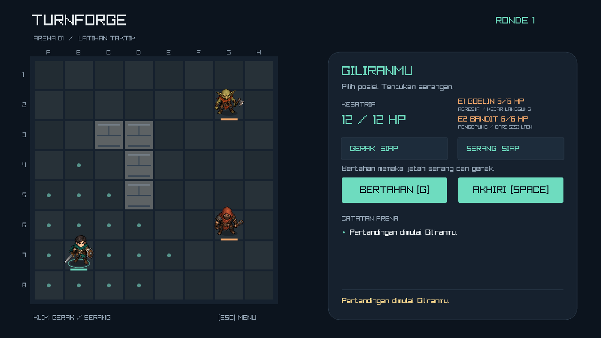
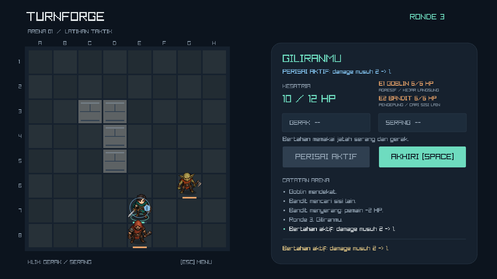

# Turnforge

A small, offline turn-based tactical game built with C++17 and raylib 5.5.

Move across an 8x8 arena, choose between attacking and guarding, and defeat two enemies. The project focuses on BFS pathfinding, deterministic enemy AI, validated gameplay rules, and a playable Windows build.



## Play

Extract the complete Windows release package, then open `turnforge.exe`. Keep the bundled `assets` folder beside the executable. No compiler, account, or network connection is required to play.

| Input | Action |
|---|---|
| Enter / Start | Start a new match |
| Left click a reachable tile | Move up to three orthogonal steps, once per turn |
| Left click an adjacent enemy | Attack once; attacking also consumes the remaining move |
| G / Guard | Spend the attack and remaining move to reduce every enemy hit from 2 to 1 until the next player turn |
| Space / End Turn | End the player turn, including when skipping all actions |
| R / Play Again on the result screen | Restart |
| Escape | Return to title; the next Start creates a new match |
| Window close button | Exit |

Movement dots show reachable tiles. The teal-cloaked knight is the player; E1 is the goblin and E2 the hooded bandit. Rings show the active unit or an attackable target, while bars/numbers show HP. Invalid actions explain why they were rejected and do not consume gameplay actions. Movement follows the grid path; attacks show a short lunge, slash, hit flash, and floating damage. Input waits briefly for an action's presentation to finish; Escape remains available.

## Guard — v0.4

You may move before guarding, or guard without moving. You cannot guard after attacking, attack after guarding, or move again after guarding. Press Space to end the turn explicitly. A blue shield and the HUD indicate active protection; it reduces every hit during the following enemy phase and expires when your next turn starts, even if nobody attacks. Guard does not heal, stack, or prevent lethal damage.



## Enemy tactics — v0.3

| Enemy | Behavior |
|---|---|
| Goblin (E1) | Takes the shortest reachable path to an attack tile |
| Bandit (E2) | Prefers an attack tile farther from the living goblin, taking at most two extra planned path steps compared with the shortest route |

Both still move at most two tiles per turn, deal 2 damage before Guard reduction, and attack immediately when already adjacent. If the goblin is defeated, the bandit pursues directly. Blocked goals are ignored; an enemy with no route waits. Decisions are deterministic and recomputed using the latest positions. The HUD shows each role and the journal reports the bandit's attempt to find another side.

Tip: finish an injured enemy when possible instead of splitting attacks between both opponents.

## Build on Windows

From a source checkout, requirements are a C++17 compiler on PATH (the provided script uses MinGW-w64 `g++` and `gcc`), PowerShell, and an OpenGL 3.3-capable graphics driver. The script uses CMake on PATH or a project-local portable copy. The first dependency download requires internet; versions and archive hashes are pinned.

```powershell
powershell -ExecutionPolicy Bypass -File scripts/build.ps1 -Package
```

The game is built to `build/Release/turnforge.exe`. The tested package is installed to `dist/Turnforge/`; the ZIP is `dist/Turnforge-Windows.zip`.

For a normal CMake installation (including other supported compilers/platforms), use:

```sh
cmake -S . -B build/manual -DCMAKE_BUILD_TYPE=Release
cmake --build build/manual --parallel 2
ctest --test-dir build/manual --output-on-failure
```

Only Windows is a verified release target. CMake can build the core tests without downloading raylib or opening a window:

```sh
cmake -S . -B build/core -DTURNFORGE_BUILD_GAME=OFF
cmake --build build/core --parallel 2
ctest --test-dir build/core --output-on-failure
```

## Design

- `src/game.h` / `src/game.cpp`: grid, BFS, occupancy, action validation, damage, turns, deterministic AI, and terminal states. No dependency on raylib.
- `src/main.cpp`: input mapping, rendering, enemy presentation timer, and optional automated render verification.
- `src/characters.h` / `src/characters.cpp`: sprite loading, alpha bounds, facing, idle/movement/attack/hit/death presentation, and animation self-checks.
- `tests/game_tests.cpp`: always-active checks for invalid moves/targets, shortest paths, blocked AI, turn order, death, complete matches, and ten restarts. Checks remain active in Release builds.
- [PRD](PRD.md): Indonesian product requirements, scope, rules, and acceptance criteria.
- [Technical note](docs/technical-note.md): pathfinding and turn-management decisions.
- [Verification](docs/verification.md): measured checks and practical limits.

The core suite contains 20 gameplay scenarios / 268 checks, including distinct roles, opposite-side positioning, detour limits, solo/blocked/adjacent/corner fallbacks, a complete focus-fire victory, and Guard action costs, expiry, damage, reset, and lethal-hit behavior. The render verifier also checks the character atlas, animation behavior, and reduced-damage presentation. Current measurements and limits are recorded in [Verification](docs/verification.md).

The map and starting stats are constants. A single BFS explores at most 64 tiles; movement costs are uniform, so A* and a separate engine framework are unnecessary. Occupancy is derived from living units rather than a duplicate mutable grid. Enemies act in stable spawn order and re-evaluate occupancy before each move.

## Automated rendering checks

```powershell
build/Release/turnforge.exe --smoke-test --capture-dir docs/screenshots
build/Release/turnforge.exe --benchmark-seconds 180 --capture-dir build/benchmark
```

These modes use a hidden game window, exercise title/gameplay/enemy/victory/defeat/restart plus movement/attack/Guard views, and save ten screenshots plus timing results. The character self-check covers a route around a wall, completed movement, attack/hit timers, actual damage amounts, death fade, restart, and returning to title during movement. Benchmark mode runs at the same 1280x720 resolution and 60 FPS cap as the game, choosing Guard every fourth automated player action. Hidden-window measurements do not replace interactive testing on the target laptop.

For process memory sampling, screenshot-dimension checks, and exit-code verification:

```powershell
powershell -ExecutionPolicy Bypass -File scripts/verify.ps1 -BenchmarkSeconds 180
```

## Scope and attribution

One fixed map, one player, two melee enemies, no saving or networking. There is no audio. Character artwork is a generated 2D atlas with lightweight code-driven animation, not a frame-by-frame animation set; [asset provenance and generation prompt](docs/art-assets.md) are included. Core code, UI, and artwork were created with AI assistance; the repository owner should study the implementation and describe their own contribution accurately when using it as a portfolio project. Third-party source and licensing are documented in [THIRD_PARTY_NOTICES.md](THIRD_PARTY_NOTICES.md).
