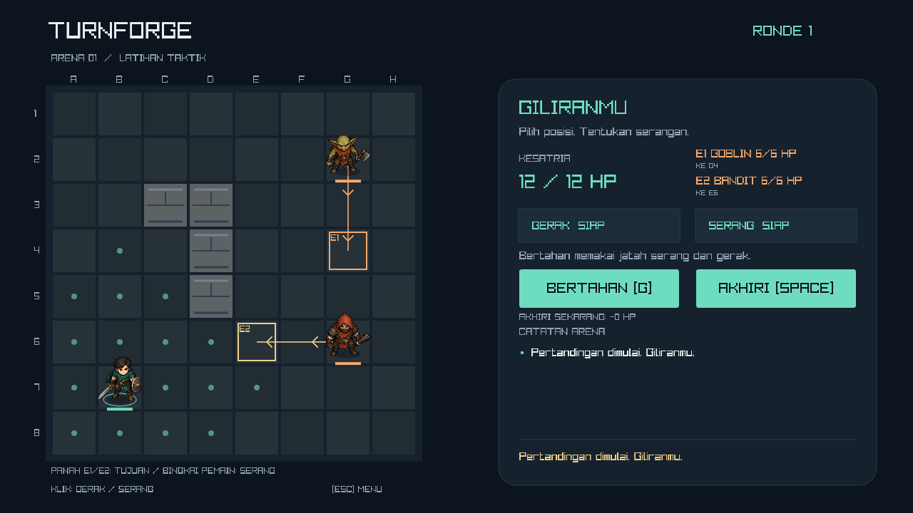
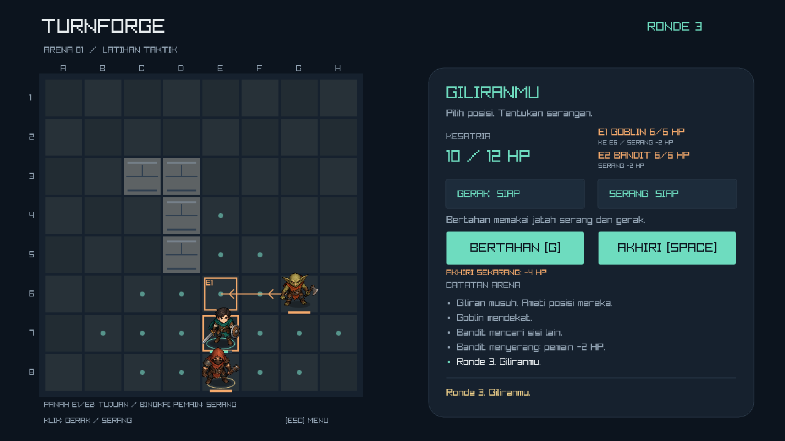
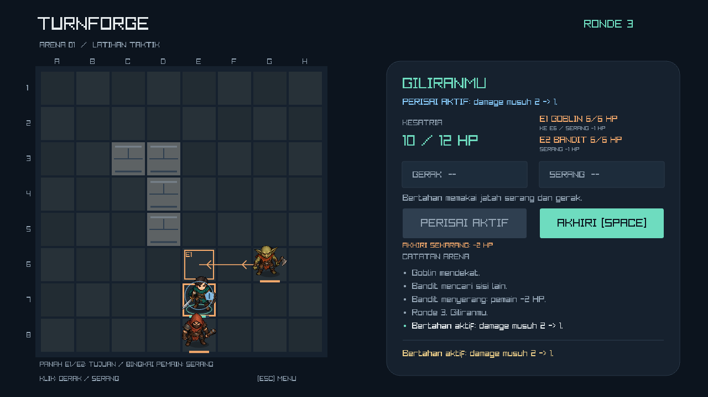

# Turnforge

A small, offline turn-based tactical game built with C++17 and raylib 5.5.

**Current version:** v0.5.0 · **Verified platform:** Windows · **Genre:** 2D tactical strategy

Move across an 8x8 arena, choose between attacking and guarding, and defeat two enemies. The project focuses on BFS pathfinding, deterministic enemy AI, validated gameplay rules, and a playable Windows build.



[Gameplay](#gameplay) · [Play and controls](#play) · [Build](#build-on-windows) · [Design](#design) · [Measured results](#measured-results) · [Tests](#automated-rendering-checks) · [Attribution](#scope-and-attribution)

## Gameplay

Control a teal-cloaked knight against a goblin and a hooded bandit in one fixed arena. Use walls and movement range to choose an approach, focus attacks to remove an enemy, or spend your attack on Guard. Defeat both enemies to win; reaching zero HP ends the match immediately.

| Rule | Player | Each enemy |
|---|---|---|
| Starting HP | 12 | 6 |
| Damage per attack | 3 | 2, reduced to 1 against Guard |
| Movement per turn | Up to 3 tiles | Up to 2 tiles |
| Attack range | One orthogonal neighbor | One orthogonal neighbor |
| Actions per turn | Up to one move and one attack or Guard; attacking/guarding closes movement | Up to one move and one attack |

Movement and combat use four directions. Walls and living units block paths. The player acts first, enemies act in spawn order, and the player explicitly ends each turn. Matches can be restarted after either result.

## What this project demonstrates

| Area | Implementation | Code or evidence |
|---|---|---|
| C++ gameplay rules | Action validation, damage, Guard expiry, and immediate win/loss transitions | [Game model](src/game.cpp) |
| Pathfinding | BFS distances and route reconstruction on a uniformly weighted grid | [Technical note](docs/technical-note.md) |
| Enemy AI | Direct pursuit and a deterministic flank preference with a bounded detour | [AI diagram](docs/images/06-ai-musuh.png) |
| Rules and presentation | Gameplay code independent of raylib; sprite effects observe model changes | [Model interface](src/game.h), [character presentation](src/characters.cpp) |
| Verification | Always-active Release checks, scripted rendering, memory sampling, and package checks | [Gameplay tests](tests/game_tests.cpp), [verification report](docs/preview-verification.md) |
| Delivery | CMake build, pinned dependency archives, offline Windows packaging | [Build script](scripts/build.ps1) |

## Play

Extract the complete Windows release package, then open `turnforge.exe`. Keep the bundled `assets` folder beside the executable. No compiler, account, or network connection is required to play.

This repository contains the source, artwork, and documentation. Build outputs and the Windows ZIP are generated locally with the command below; they are not committed to Git.

| Input | Action |
|---|---|
| Enter / Start | Start a new match |
| Left click a reachable tile | Move up to three orthogonal steps, once per turn |
| Left click an adjacent enemy | Attack once; attacking also consumes the remaining move |
| G / Guard | Spend the attack and remaining move to reduce every enemy hit from 2 to 1 until the next player turn |
| Space / End Turn | End the player turn, including when skipping all actions |
| R / Play Again on the result screen | Restart |
| Escape | Return to title; the next Start creates a new match |
| Window close button | Exit |

Movement dots show reachable tiles. The teal-cloaked knight is the player; E1 is the goblin and E2 the hooded bandit. Rings show the active unit or an attackable target, while bars/numbers show HP. Invalid actions explain why they were rejected and do not consume gameplay actions. Movement follows the grid path; attacks show a short lunge, slash, hit flash, and floating damage. Input waits briefly for an action's presentation to finish; Escape remains available.

## Enemy preview — v0.5

During an idle player turn, arrows labeled E1/E2 show the next enemy movement, outlined destinations show where they will stop, and an orange border on the player tile marks an incoming attack. The HUD lists each enemy action and the HP you would lose **if you end the turn now**, with a warning for a lethal result.

The forecast uses a copy of the current match and the same enemy-turn code as live play. It updates after moving, killing an enemy, or guarding; it accounts for spawn order, changed occupancy, blocked enemies, solo pursuit, Guard, and cancellation after a lethal hit. HP loss is capped at remaining HP. It does not alter the match or commit an enemy action. The overlay hides during blocking action animations, enemy turns, title, and results. No extra key is needed.



In the captured example, ending the turn costs 4 HP; activating Guard changes the forecast to 2 HP. Changing your actions can change the forecast.

## Guard — v0.4

You may move before guarding, or guard without moving. You cannot guard after attacking, attack after guarding, or move again after guarding. Press Space to end the turn explicitly. A blue shield and the HUD indicate active protection; it reduces every hit during the following enemy phase and expires when your next turn starts, even if nobody attacks. Guard does not heal, stack, or prevent lethal damage.



## Enemy tactics — v0.3

| Enemy | Behavior |
|---|---|
| Goblin (E1) | Takes the shortest reachable path to an attack tile |
| Bandit (E2) | Prefers an attack tile farther from the living goblin, taking at most two extra planned path steps compared with the shortest route |

Both still move at most two tiles per turn, deal 2 damage before Guard reduction, and attack immediately when already adjacent. If the goblin is defeated, the bandit pursues directly. Blocked goals are ignored; an enemy with no route waits. Decisions are deterministic and recomputed using the latest positions. The HUD shows each role and the journal reports the bandit's attempt to find another side.

Tip: finish an injured enemy when possible instead of splitting attacks between both opponents.

## Build on Windows

From a source checkout, requirements are a C++17 compiler on PATH (the provided script uses MinGW-w64 `g++` and `gcc`), PowerShell, and an OpenGL 3.3-capable graphics driver. The script uses CMake on PATH or a project-local portable copy. The first dependency download requires internet; versions and archive hashes are pinned.

Clone the repository first. Access to this private repository requires an authorized GitHub account.

```powershell
git clone https://github.com/a1fariz/turnforge.git
cd turnforge
```

```powershell
powershell -ExecutionPolicy Bypass -File scripts/build.ps1 -Package
```

The game is built to `build/Release/turnforge.exe`. The tested package is installed to `dist/Turnforge/`; the ZIP is `dist/Turnforge-Windows.zip`.

For a normal CMake installation (including other supported compilers/platforms), use:

```sh
cmake -S . -B build/manual -DCMAKE_BUILD_TYPE=Release
cmake --build build/manual --config Release --parallel 2
ctest --test-dir build/manual -C Release --output-on-failure
```

Only Windows is a verified release target. CMake can build the core tests without downloading raylib or opening a window:

```sh
cmake -S . -B build/core -DTURNFORGE_BUILD_GAME=OFF
cmake --build build/core --config Release --parallel 2
ctest --test-dir build/core -C Release --output-on-failure
```

## Design


- `src/game.h` / `src/game.cpp`: grid, BFS, occupancy, action validation, damage, turns, deterministic AI, and terminal states. No dependency on raylib.
- `src/main.cpp`: input mapping, rendering, enemy presentation timer, and optional automated render verification.
- `src/characters.h` / `src/characters.cpp`: sprite loading, alpha bounds, facing, idle/movement/attack/hit/death presentation, and animation self-checks.
- `tests/game_tests.cpp`: always-active checks for invalid moves/targets, shortest paths, blocked AI, turn order, death, complete matches, and ten restarts. Checks remain active in Release builds.
- [Stress tests](tests/qa_stress.cpp): seeded sessions, an independent path-distance oracle, state invariants, and deterministic replay.
- [PRD](PRD.md): Indonesian product requirements, scope, rules, and acceptance criteria.
- [Technical note](docs/technical-note.md): pathfinding and turn-management decisions.
- [v0.5 verification](docs/preview-verification.md): preview correctness, measured checks, and practical limits.
- [Previous full QA](docs/qa-report.md): the v0.4.1 baseline and fixed benchmark defects.

The core suite contains 24 gameplay scenarios / 352 checks, including distinct roles, opposite-side positioning, detour limits, solo/blocked/adjacent/corner fallbacks, a complete focus-fire victory, and Guard action costs, expiry, damage, reset, and lethal-hit behavior. Preview cases compare actual AI turns with forecasts, check read-only state, and cover movement/kill/Guard updates, lethal cancellation, blocked/corner cases, and phase restrictions. The render verifier also checks the character atlas, animation behavior, and reduced-damage presentation. Current measurements and limits are recorded in [v0.5 verification](docs/preview-verification.md).

CTest also runs a separate deterministic stress suite: 500 seeded sessions, 64,433 actions, and 1,126,045 checks. It compares paths with an independent distance oracle and checks occupancy, HP, rejected actions, and identical-state replay. Both suites passed in Release and in direct Debug builds with checked standard-library assertions. This is correctness coverage, not a player win-rate or balance study.

The map and starting stats are constants. A single BFS explores at most 64 tiles; movement costs are uniform, so A* and a separate engine framework are unnecessary. Occupancy is derived from living units rather than a duplicate mutable grid. Enemies act in stable spawn order and re-evaluate occupancy before each move.

## Measured results

The v0.5.0 Release build was checked on Windows with an Intel Core i5-10310U and Intel UHD Graphics at 1280x720. These are local observations from 30 October 2026.

| Check | Recorded result |
|---|---|
| Core rules | 24/24 scenarios; 352 checks passed |
| Sustained hidden-window run | 180.013 seconds without a crash |
| Mean frame time | 17.120 ms, approximately 58.4 FPS |
| p95 frame time | 18.043 ms |
| Maximum timed enemy decision | 0.7797 ms |
| Peak process working set | 142.59 MB |
| Render smoke check | Eleven screenshots, preview, Guard, victory/defeat, and ten restarts passed |
| Windows package | Passed with PATH restricted to Windows system directories |

The 60 FPS target was not fully reached in this run. Hidden-window results do not guarantee visible-window performance; physical mouse/keyboard playtesting and broader balance testing remain outstanding. See the [current verification report](docs/preview-verification.md) for methods, raw reports, and limits.

## Automated rendering checks

```powershell
build/Release/turnforge.exe --smoke-test --capture-dir build/smoke
build/Release/turnforge.exe --benchmark-seconds 180 --capture-dir build/benchmark
```

These modes use a hidden game window, exercise title/gameplay/enemy/victory/defeat/restart plus movement/attack/Guard/preview views, and save eleven screenshots plus timing results. The character self-check covers a route around a wall, completed movement, attack/hit timers, actual damage amounts, death fade, restart, and returning to title during movement. Benchmark mode runs at the same 1280x720 resolution and 60 FPS cap as the game, choosing Guard every fourth automated player action. Hidden-window measurements do not replace interactive testing on the target laptop.

Automated runs also replay raylib keyboard/mouse events through the actual input controller: Enter/Start, valid and invalid clicks, G/Guard, Space/End Turn, R/Restart, Escape, phase restrictions, and animation locks. A window-close event checks the application's close state. These events do not operate the physical desktop. A short positive benchmark duration still completes the required 360-frame smoke sequence before finishing; malformed numeric durations are rejected before the renderer opens.

For process memory sampling, screenshot-dimension checks, and exit-code verification:

```powershell
powershell -ExecutionPolicy Bypass -File scripts/verify.ps1 -BenchmarkSeconds 180
```

To check command-line validation, missing/corrupt/incomplete assets, a spaced output path, and a short benchmark:

```powershell
powershell -ExecutionPolicy Bypass -File scripts/test-cli.ps1
```

The [v0.5 report](docs/preview-verification.md) records current checks and remaining manual work. The [v0.4.1 QA report](docs/qa-report.md) is retained as historical evidence.

## Scope and attribution

One fixed map, one player, two melee enemies, no saving or networking. There is no audio. Character artwork is a generated 2D atlas with lightweight code-driven animation, not a frame-by-frame animation set; [asset provenance and generation prompt](docs/art-assets.md) are included. Core code, UI, and artwork were created with AI assistance; the repository owner should study the implementation and describe their own contribution accurately when using it as a portfolio project. Third-party source and licensing are documented in [THIRD_PARTY_NOTICES.md](THIRD_PARTY_NOTICES.md).
