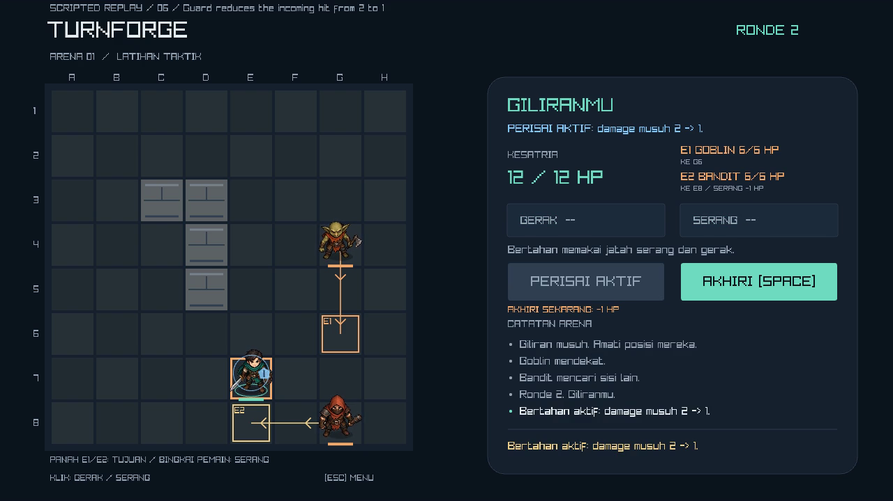

# Turnforge gameplay demo — v0.5.1

The local demo is a **66-second, 1280×720, 30 FPS, H.264 MP4** at `dist/Turnforge-Demo.mp4`. It is a scripted replay of one complete match from the default map and stats, with English chapter captions over the Indonesian game UI. The video has no audio, matching the game's current scope.

The video binary is a generated local artifact. The repository contains the recorder, poster, storyboard, and verification evidence; portfolio/video hosting and CV updates remain deferred.



## Storyboard

| Time | Scene |
|---|---|
| 00:00–00:03 | Title and project identity |
| 00:03–00:06 | Read the arena; a wall click is rejected without consuming an action |
| 00:06–00:11 | Hover a reachable destination, display its BFS route, then move three tiles |
| 00:11–00:16 | Goblin and bandit resolve their different approaches |
| 00:16–00:20 | Inspect the next turn's forecast: 2 HP would be lost |
| 00:20–00:24 | Activate Guard; forecast updates to 1 HP |
| 00:24–00:30 | Enemy turn applies the reduced hit and protection expires |
| 00:30–00:39 | Attack the bandit and let enemies resolve |
| 00:39–00:48 | Finish the bandit; its tile becomes free |
| 00:48–00:57 | Attack the remaining goblin |
| 00:57–01:06 | Final attack, finishing animation, and victory in round 6 with 3 HP |

The replay drives Enter, mouse events, G, and Space through the same input controller as ordinary play. The normal rules and enemy timers resolve every action. The recorder checks the rejected move, valid movement, four successful attacks, actual Guard reduction, and final winning state. Its visible `SCRIPTED REPLAY` label identifies the recording method.

## Reproduce

From the source checkout on Windows:

```powershell
powershell -ExecutionPolicy Bypass -File scripts/build.ps1
powershell -ExecutionPolicy Bypass -File scripts/record-demo.ps1
```

The script uses FFmpeg on PATH when available. Otherwise it extracts a pinned Windows encoder into `.tools/`; the first download requires internet. Python is not required to use the extracted executable. The game and finished video play independently of the encoder.

The script captures a fresh image sequence under `build/demo/<run-id>/`, encodes an MP4 with fast-start metadata, decodes the complete result, and checks 1,980 video frames, H.264, 1280×720, 30 FPS, and a 66-second duration. Capture reports and logs remain in that build directory. Recording can take several minutes on the target laptop.

For a different built executable or destination:

```powershell
powershell -ExecutionPolicy Bypass -File scripts/record-demo.ps1 -Executable dist/Turnforge/turnforge.exe -OutputFile dist/Turnforge-Demo.mp4
```

The underlying `--demo-dir <directory>` option is a recording mode. It rejects combination with smoke or benchmark modes. It renders a fixed 1/30-second simulation step into PNG frames and closes after 1,980 frames; the wrapper creates the video. Normal play retains its existing time step and 60 FPS cap.

## Verification

Final media verification and sampled encoded-frame inspection are recorded in [demo-verification.json](demo-verification.json). The Release core suite (24 scenarios / 352 checks) and 500-session stress suite passed again. [Gameplay/input/render regression](demo-gameplay-regression.json) passed all required fields; [CLI and asset regression](demo-cli-results.json) passed 20 cases, including the three recording-option rejection cases. Seven encoded samples at 0, 4, 6, 22, 31, 40, and 60 seconds were visually inspected. The replay ends with four attacks, verified Guard damage reduction, and victory in round 6 with 3 HP. This offline capture is not a measurement of real-time rendering performance or evidence of human mouse/keyboard playtesting. [Gameplay/performance baseline](preview-verification.md).

The Windows ZIP was extracted into a fresh directory outside the source tree with spaces in its path. With PATH restricted to Windows/System32, the [package verifier](demo-package-verification.json) passed all required gameplay, input, character, preview, result, and reset checks. Executable, atlas, and bundled license hashes matched the installed package.

A later sequential 30-second hidden-window comparison recorded **25.817 ms/frame (~38.7 FPS)** for the previous v0.5.0 build and **25.103 ms/frame (~39.8 FPS)** for v0.5.1. Both passed all required checks. These runs were slower than the earlier three-minute baseline and showed similar results for the two builds under the current conditions. They do not isolate the cause or establish a performance improvement; the 60 FPS target remains unmet in these measurements. Visible, focused gameplay has not been manually benchmarked. Raw reports: [old build](demo-performance-old-verification.json), [new build](demo-performance-new-verification.json), [old memory](demo-performance-old-memory.json), [new memory](demo-performance-new-memory.json).

The recorder flushes drawing and captures the current back buffer before the window buffer swap, keeping the first frame and chapter changes aligned with the corresponding action.

## Encoder provenance

The fallback tool comes from [imageio-ffmpeg 0.7.0 on PyPI](https://pypi.org/project/imageio-ffmpeg/0.7.0/), file `imageio_ffmpeg-0.7.0-py3-none-win_amd64.whl`, SHA-256 `7a22b45f60321d4172bdf2bc61f716bce4c81b85727bd59c7c7e371055a6a440`. Its bundled executable identifies as FFmpeg 7.1 essentials from Gyan, with libx264 enabled. The archive, encoder, and retained package metadata stay under `.tools/` and are excluded from Git and the Windows game package. Existing character artwork and its [provenance](art-assets.md) are unchanged.
